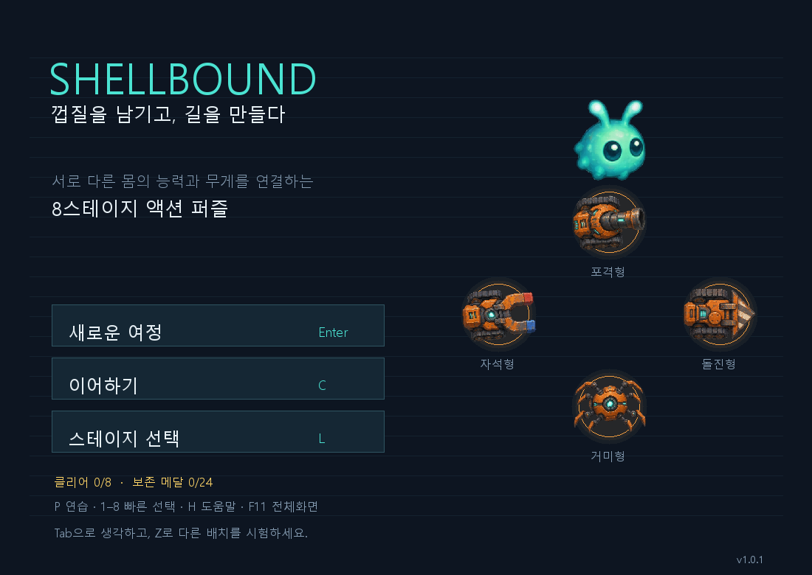
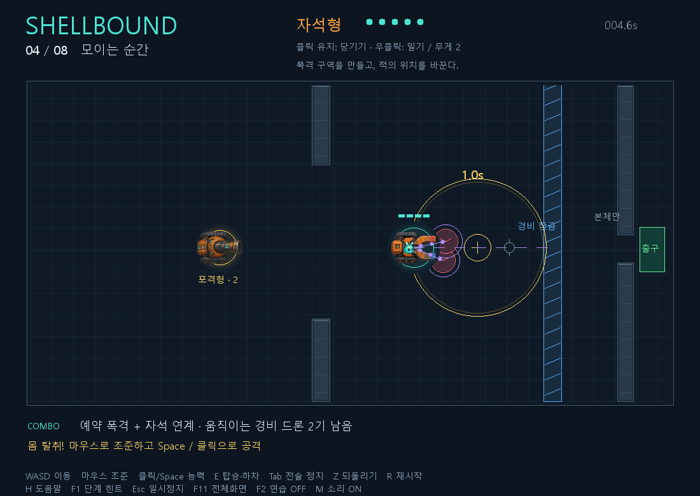
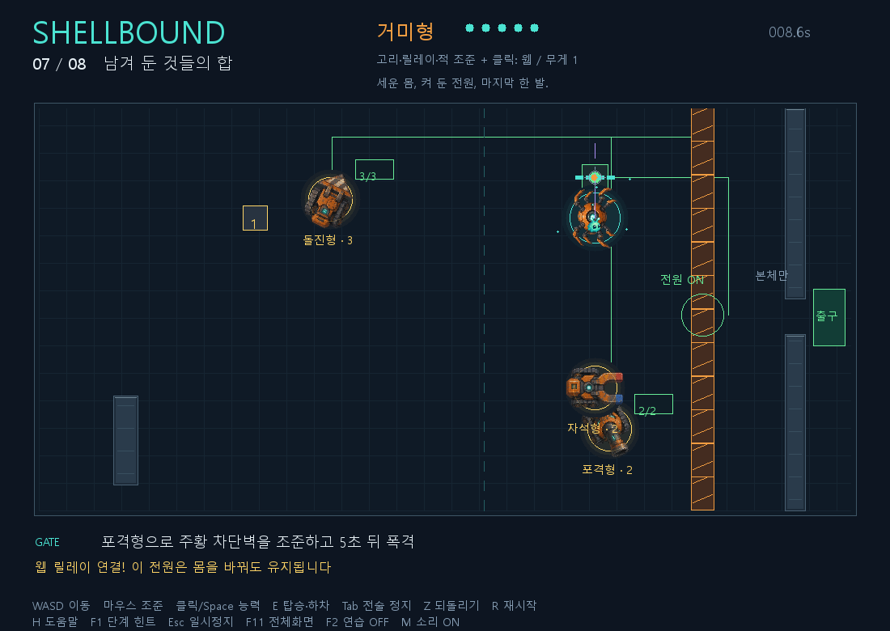

# SHELLBOUND

**기체를 빼앗고, 필요한 몸을 남겨서 길을 여는 8스테이지 액션 퍼즐.**

돌진형·포격형·자석형·거미형의 능력과 무게를 연결합니다. 손이 빠른 것만으로 해결하기보다, 어떤 몸을 어디에 두고 어떤 순서로 사용할지 판단하는 게임입니다.



## 실행

Windows / Python 3.10 이상. 프로젝트 폴더에서:

```powershell
python -m pip install -r requirements.txt
python main.py
```

**`PLAY_TAKEOVER.bat` 더블클릭**으로도 실행합니다. 이미지와 소리는 프로젝트에 포함되거나 로컬에서 생성되므로 게임 실행 시 별도 다운로드가 필요하지 않습니다.

- **Enter** 새 여정 / **C** 이어하기 / **L** 스테이지 선택
- **F11** 전체화면
- 잠긴 방도 선택 후 **P**로 피해 없는 연습 가능
- 개발·검증용 특정 방 실행: `python main.py --stage 4` (1–8)

## 조작

| 입력 | 행동 |
|---|---|
| WASD | 이동 |
| 마우스 | 능력 방향·폭격 위치 조준 |
| 클릭 / Space | 현재 몸의 능력. 본체는 이동 방향으로 짧은 스텝 |
| 클릭 / Space 유지 | 자석형의 끌어당기기 |
| 우클릭 | 자석형의 밀어내기 |
| E | 가까운 기절/빈 기체에 탑승, 현재 몸에서 하차 |
| 이동키 + E | 내릴 방향 지정 |
| **Tab** | **전술 일시정지. 폭격 카운트다운과 적도 멈춤** |
| **Z** | **현재 방에서 이전 행동·배치로 되돌리기** |
| F1 | 방별 힌트. 누를 때마다 다음 힌트 |
| R | 현재 방 재시작 |
| H | 조작과 기체 도움말 |
| Esc / Backspace | 일시정지 / 시작 화면으로 |
| F2 / F4 / M | 연습 모드 / 화면 흔들림 / 전체 소리 전환 |

## 네 가지 몸

| 기체 | 무게 | 역할 |
|---|---:|---|
| 돌진형 | 3 | 고정 방향 돌진. 장갑·균열벽을 깨고, 무거운 압력판에 남겨둘 수 있음 |
| 포격형 | 2 | 지정한 구역에 **5초 뒤 예약 폭격**. 내려도 명령 유지 |
| 자석형 | 2 | 앞쪽의 적·상자·빈 기체를 당기거나 밀어내서 위치를 바꿈 |
| 거미형 | 1 | 구덩이 통과, 고리로 웹 이동, 전원 릴레이 연결과 드론 묶기 |
| 작은 본체 | 0 | 빠르게 이동하고 좁은 틈 통과. 압력판은 누를 수 없음 |

**벗은 몸은 사라지지 않습니다.** 빈 기체는 직선 탄을 막고 압력판을 계속 누릅니다. 진행 중인 돌진과 예약 폭격은 하차 뒤에도 남은 명령을 수행합니다.

주황 파괴벽은 폭격이 실제로 닿은 패널이 부서집니다. 위쪽을 맞히면 위쪽에 구멍이 나며, 남은 조각도 추가 공격으로 부술 수 있습니다. 전원이 필요한 벽은 압력판·릴레이 조건을 먼저 충족해야 합니다.

폭격은 적뿐 아니라 **남겨 둔 기체도 파괴**합니다. 필요한 몸을 보존해야 하는 퍼즐방에서는 무조건 공격하는 것이 정답이 아닙니다. 실수했다면 Z로 되돌려 다른 배치를 시험하세요.



## 캠페인

| 방 | 이름 | 중심 과제 |
|---|---|---|
| 1 | 탈취의 시작 | 공격을 유도해 기체를 얻고, 직접 돌진해 균열벽 돌파 |
| 2 | 5초 뒤의 한 발 | 돌진형에서 포격형으로 교체하고 예약 폭격 사용 |
| 3 | 교차 사격 | 포탑·레이저의 빈틈을 보며 두 기체 활용 |
| 4 | 모이는 순간 | 움직이며 폭격을 회피하는 드론을 자석으로 모아 처리 |
| 5 | 돌아갈 몸을 남겨라 | 무거운 몸으로 압력문과 출구 전원을 유지 |
| 6 | 건너편의 전원 | 거미형으로 구덩이를 건너 전원을 연결하고 포격형으로 교체 |
| 7 | 남겨 둔 것들의 합 | 압력판 두 개와 릴레이를 연결. 무엇을 어디에 남길지 선택 |
| 8 | 정원의 심장 | 방패를 여는 방법과 안전 장치를 찾아 관리자를 정지시키는 보스전 |



전투방에서는 회피와 조준을, 퍼즐방에서는 **기체의 배치·보존·사용 순서**를 활용합니다. 거미형의 안전 릴레이, 자석으로 옮기는 전지, 돌진 충격 등으로 다른 공략을 선택할 수도 있습니다.

## 진행 저장과 재도전

- 일반 모드 클리어 시 다음 방과 기록 자동 저장: `.cache/progress-v2.json`
- 기존 공개 빌드의 첫 세 방은 처음부터 선택 가능. 이후 방은 순서대로 해금
- 방마다 본체 체력과 기체 초기화, R은 **현재 방만** 재시작
- 보존 메달: 클리어 / 본체 체력 보존 / 기체 보존. 빠른 기록만을 요구하지 않음
- 연습 모드를 한 번이라도 쓴 시도는 일반 기록으로 저장하지 않음
- Z는 현재 방의 최근 32개 행동/배치까지 복구. 방을 넘은 뒤에는 이전 방으로 되돌리지 않음
- 창에서 포커스가 벗어나면 자동 일시정지

5·7번 퍼즐방에서는 파괴된 기체가 자동으로 보충되지 않습니다. Z 또는 R로 복구할 수 있습니다. 나머지 방에서는 파괴된 탑승 기체가 5초 뒤 보충됩니다.

## 구현과 검증

- Python / pico2d. 시뮬레이션과 입력·화면·저장 코드를 분리
- 돌진·탄 이동은 짧은 하위 간격으로 충돌 계산
- **87개 자동 검사 통과**: 기존 모드, 능력 조합, 배치·전원·보스, 저장·되돌리기·전체화면·마우스 입력
- 8개 방 모두 일반 모드, WASD와 같은 8방향 입력만으로 클리어 검증
- 실제 앱의 키보드 입력 경로로 1→8→엔딩 연속 진행 검증
- 스크린샷은 실제 SDL 렌더러로 자동 입력 중 저장한 화면이며, 사람의 직접 플레이 영상은 아님
- 자동 검증은 사람의 재미·체감 난이도 평가를 대신하지 않음

```powershell
python -m unittest discover -v
python -m tools.playthrough_campaign
```

창을 띄우지 않는 UI 검사:

```powershell
$env:SDL_VIDEODRIVER='dummy'
$env:SDL_AUDIODRIVER='dummy'
python -m unittest discover -v
Remove-Item Env:SDL_VIDEODRIVER
Remove-Item Env:SDL_AUDIODRIVER
```

개발용 캡처 도구는 `python -m pip install -r requirements-dev.txt` 후 `python -m tools.capture_release`로 실행합니다. 추가 개발 패키지는 게임 실행에는 필요하지 않습니다.

## 이미지와 사운드

- 캐릭터와 기체: built-in ImageGen으로 생성한 아틀라스를 프로젝트용 스프라이트로 준비
- 생성 원본과 최종 프롬프트: [assets/characters/generation.json](assets/characters/generation.json)
- 캐릭터 PNG, 배경 연출·장치·UI를 함께 사용. 캐릭터 이동/회전은 코드로 표현
- 효과음은 프로젝트 코드에서 직접 합성. 사운드 장치가 없어도 게임 진행 가능

## 이전 버전과 발표자료

기존 **두 겹 갑옷 탈피 3방**은 그대로 유지합니다:

```powershell
python main.py --classic
```

`PLAY_CLASSIC.bat`로도 실행합니다. 이 모드는 새 8스테이지와 별도이며, 새 게임은 몸에서 벗어나 남긴 기체를 다시 활용하는 방향으로 확장했습니다.

- [1차 발표](presentation/1차발표.pptx)
- [상세 기획서](presentation/기획서.pptx)
- [2차 발표 PPT](presentation/second/SHELLBOUND_2차발표.pptx)
- [2차 발표 전체화면 보기](presentation/second/발표보기.html)

**2차 발표자료는 당시의 2종·3스테이지 구현 상태를 기록한 자료입니다.** 현재 4종·8스테이지의 실행 방법과 기능은 이 README를 기준으로 확인하세요.
