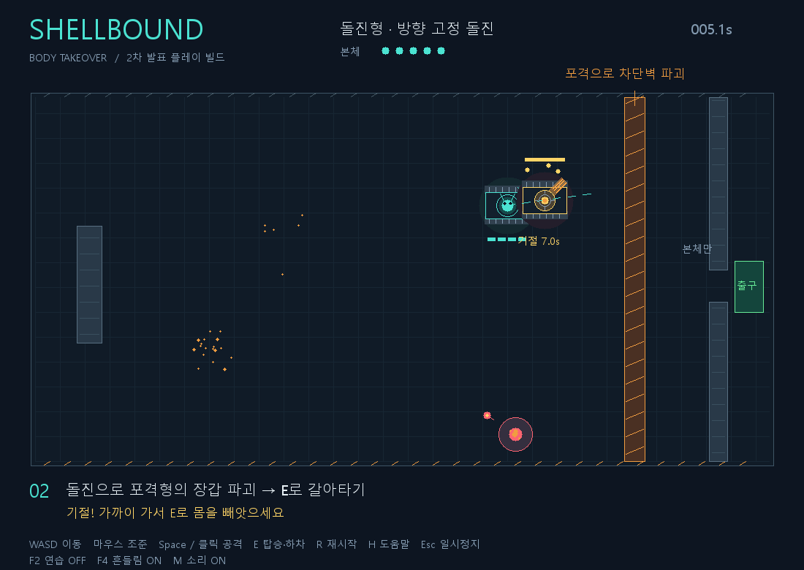

# Drill_Project — SHELLBOUND

## 2차 발표: 몸 탈취 전투방 (2026-11-16)

기본 실행은 새 몸 탈취 전투방입니다. **돌진형·포격형 2종, 전투방 1개**를 구현했습니다.
자석형·거미형과 8스테이지는 향후 계획이며 현재 구현 범위에 포함하지 않습니다.

```powershell
python -m pip install -r requirements.txt
python main.py
```

Windows에서는 `PLAY_TAKEOVER.bat`를 더블클릭할 수도 있습니다.
Enter는 실전, P는 피해 없는 연습입니다. WASD 이동, 마우스 조준,
Space/왼쪽 클릭은 탑승 기체 공격(본체일 때는 이동 스텝), E는 탑승·하차입니다.
돌진을 벽으로 유도 → 기절한 적 탈취 → 돌진으로 포격형 장갑 파괴 →
포격형 탑승 → 오른쪽 차단벽 파괴 → 하차 후 좁은 틈으로 탈출합니다.
돌진·스텝에는 무적이 없습니다. 기체가 파괴되면 본체로 탈출하며, 5초 뒤 대체 기체가 생깁니다.

- R 재시작 / Esc 일시정지 / H 도움말 / F2 연습 전환 / F4 흔들림 / M 소리
- [2차 발표 PPT (2장)](presentation/second/SHELLBOUND_2차발표.pptx)
- [계획 대비 구현 현황](presentation/second/구현현황.md)
- 자동 입력 QA: `python -m tools.verify_takeover` (게임 실제 로직 검증이며 사람 플레이 영상 아님)

기존 세 방 탈피 퍼즐은 `python main.py --classic` 또는 `PLAY_CLASSIC.bat`로 실행합니다.

### 1차 발표 이후 변경점

- 적의 공격 예고와 벽 충돌 기절, E로 몸 탈취·하차 구현.
- 돌진형의 고정 방향 돌진과 포격형의 착탄 위치 조준 구현.
- 돌진으로 장갑 파괴 → 포격형 탈취 → 차단벽 포격 → 본체로 틈 통과하는 신규 전투방 추가.
- 기체 체력·파괴 후 대체 기체, 재시작·연습·일시정지·도움말 지원.
- 기존 검사를 포함한 49개 규칙·UI 검사 통과 (SDL dummy 환경).
- 2차 발표 PPT 2장과 계획 대비 진행 상황 추가.

아래는 실제 게임 렌더러에서 저장한 검증 화면입니다. 사람의 플레이 녹화 영상은 아닙니다.



아래 내용은 **기존 버전** 설명입니다.

탈피 게임의 독립 프로젝트입니다. 수업 과제용 `Drill_12` 저장소와 별도로 관리합니다.

## 1차 발표 자료

윤형균 / 2023184021

- [발표용 PPT (7장)](presentation/1차발표.pptx)
- [상세 기획서 PPT (14장)](presentation/기획서.pptx)
- [AI 캐릭터 콘셉트](presentation/캐릭터콘셉트.png)

표지 이미지는 AI 캐릭터 콘셉트이며 게임에 적용된 최종 스프라이트가 아닙니다.
PPT는 현재의 프로토타입과 앞으로 개선할 작업을 구분해 설명합니다.

## 게임 프로토타입

벗고, 던지고, 다시 입는 2D 탈피 액션 퍼즐 프로토타입입니다.
이전 보스 생존·세 가지 미니게임 데모는 현재 버전에 포함하지 않습니다.

## 실행

Windows의 Python 3 환경에서 이 폴더를 VS Code로 열고 터미널에 입력합니다.

```powershell
python -m pip install -r requirements.txt
python main.py
```

이미지 다운로드 없이 실행됩니다. 캐릭터와 배경은 도형으로 직접 그리며,
한글은 Windows의 맑은 고딕을 사용합니다. 효과음은 실행 시 합성됩니다.
이 그래픽은 조작 검증용이며 최종 AI 캐릭터 에셋이나 발표 자료는 아닙니다.

## 조작

| 입력 | 행동 |
|---|---|
| Enter / 시작 화면 클릭 | 시작 |
| 시작 화면 1 / 2 / 3 | 원하는 방부터 시작 |
| WASD | 이동 |
| 마우스 | 중간 갑옷 발사 방향과 회수 대상 조준 |
| 방향키 누르기 | 마우스·보정을 무시하고 해당 방향으로 직선 조준 고정 |
| 왼쪽 클릭 | 조준한 방향으로 탈피·투척 (Space와 동일) |
| Space | 무거운 껍질 설치 / 중간 껍질 투척 |
| E | 회수 가능한 갑옷 쪽으로 돌진해 합체 |
| R | 현재 방 전체 재시작 |
| Esc | 일시정지 / 시작 화면에서는 종료 |
| H | 조작 도움말 |
| M | 효과음 켜기·끄기 |
| F2 | 피해 없는 연습 모드 켜기·끄기 |
| F4 | 화면 흔들림 켜기·끄기 |

## 첫 방 플레이 방법

1. Space로 무거운 갑옷을 벗습니다. 남긴 갑옷은 포탑 탄을 막습니다.
2. 마우스로 빈 곳을 조준하고 다시 Space를 누르면 중간 갑옷을 던집니다.
3. 작은 본체로 가운데 벽의 좁은 틈을 지나 노란 열쇠를 얻습니다.
4. 초록 출구에 도착하고 Enter로 다음 방으로 갑니다.

갑옷 회수는 작은 본체 → 중간 → 무거운 순서입니다.
340픽셀 안에 있고 벽이 경로를 막지 않는 갑옷에 E 표시가 나타납니다.
날아가는 중인 갑옷은 멈춘 뒤 회수할 수 있습니다.
작은 본체는 빠르지만 피해를 두 배로 받습니다. 막혔다면 R로 다시 시작하세요.

두 번째 방에서는 중간 갑옷으로 스위치를 맞혀 문을 엽니다.
세 번째 방에서는 열쇠를 얻고 출발 쪽 출구로 돌아옵니다.
적에게 갑옷을 던지면 처치할 수 있지만 모든 적을 잡을 필요는 없습니다.
중간 갑옷의 점선은 실제 투척 사거리와 벽 충돌 위치를 보여줍니다.
적 또는 스위치 가까이에 마우스를 대면 초록색 조준 보정 표시가 나타납니다.
보정은 12도 이내의 가까운 조준만 도우며, 벽 너머나 사거리 밖에는 적용되지 않습니다.
던진 중간 갑옷은 옆으로 회전하며 첫 방의 좁은 틈을 통과할 수 있습니다.
틈에서 수평으로 던지려면 중간 갑옷을 입고 **→를 누른 채 왼쪽 클릭 또는 Space**를 누릅니다.
위아래 방향키로는 정확히 수직으로 던질 수 있습니다. 방향키 조준에는 자동 보정이 적용되지 않습니다.
Windows 화면 배율과 관계없이 마우스 좌표를 게임 캔버스 좌표로 변환합니다.
중간 갑옷을 입은 캐릭터는 여전히 틈을 통과할 수 없습니다.
갑옷이 틈 안에서 멈추면 마지막으로 착용 가능한 위치에 놓여 회수 불능 상태를 방지합니다.
적이 갑옷을 입는 기능은 이번 기획에서 제외했습니다.

## 검증

```powershell
python -m unittest -v
```

규칙·통행 경로·진행·재시작을 검사합니다.
창을 띄우지 않는 화면·입력 통합 검사는 다음처럼 실행합니다.

```powershell
$env:SDL_VIDEODRIVER='dummy'
$env:SDL_AUDIODRIVER='dummy'
python -m unittest -v
Remove-Item Env:SDL_VIDEODRIVER
Remove-Item Env:SDL_AUDIODRIVER
```

`shellgame/`는 실제 게임 소스이며 자동 생성 효과음은 `.cache/`에 저장되어 Git에서 제외됩니다.
현재는 세 방짜리 플레이 테스트용 버전이며 실제 사용자 플레이로 난이도를 조절할 예정입니다.
